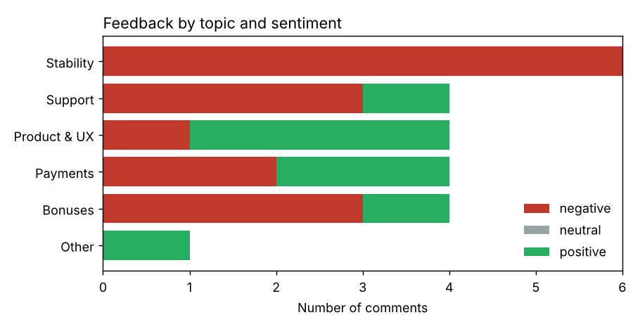

# Customer Feedback NLP

[](https://github.com/mantas123456/NLP_Player_Feedback_Analysis/actions/workflows/ci.yml)

Tags short customer comments by topic, extracts named entities, and scores sentiment with
two lexicon methods (TextBlob and VADER). It then checks those scores against hand labels,
which shows where off-the-shelf sentiment breaks down. Comes as a command-line tool and a
Streamlit app.

The sample data is 20 comments of the kind an online gaming or betting platform receives.



## Finding: lexicon sentiment misses most complaints

| Method | Accuracy | Negative comments found | Called neutral |
|---|---:|---:|---:|
| TextBlob | 55% | 4 of 13 | 6 |
| VADER | 55% | 5 of 13 | 4 |

Both methods score words, not situations. Real complaints are often factual and contain no
emotional words:

- *"The app crashed every time I tried placing a bet"*: both methods say neutral.
- *"I won €500 but it took 4 days to withdraw it"*: TextBlob neutral, VADER positive (because of "won").
- *"Please fix the loading times, it's way too slow!"*: VADER positive.

For a support team, missing two thirds of complaints defeats the purpose. Topic tagging
holds up better: every stability comment is negative, while product and UX comments are
mostly positive. That points to where to look first even without reliable sentiment.

With 20 comments these numbers show a failure pattern, not a benchmark. Next steps:
a larger labelled set, and a transformer sentiment model or a small classifier trained on
labelled complaints, compared on the same labels.

## What it does

| Step | Method |
|---|---|
| Cleaning | spaCy lemmatisation, stop-word and punctuation removal |
| Entities | spaCy NER (money, dates, quantities, …) |
| Topics | Lemma keyword rules for Payments, Support, Stability, Bonuses and Product & UX. A comment can have several. |
| Sentiment | TextBlob polarity and VADER compound score, labelled at ±0.1 |
| Evaluation | Accuracy and negative recall against the `label` column, when present |

## Run it

```bash
git clone https://github.com/mantas123456/NLP_Player_Feedback_Analysis
cd NLP_Player_Feedback_Analysis
pip install -e ".[app,dev]"
python -m spacy download en_core_web_sm

python -m feedback_nlp data/feedback.csv --out outputs   # writes CSV, chart, accuracy table
streamlit run app/app.py                                 # one comment or a whole CSV
pytest
```

Input: a CSV with a `feedback` column, plus an optional `label` column
(positive, negative or neutral).

## Layout

```
src/feedback_nlp/     analysis code and command-line entry point
app/app.py            Streamlit app (replaces the separate streamlit_nlp_app repo)
data/feedback.csv     20 sample comments with hand labels
outputs/              results from the last run
notebooks/            original v1 exploration notebook
tests/
```

## History

- **v2.0** (2026). Merged the Streamlit app into this repo. Added topic tagging, a VADER
  comparison, evaluation against hand labels, tests and CI. Replaced the script with a package.
- **v1.0** (2025). spaCy and TextBlob pipeline with charts.

## How this was built

I designed the analysis and checked the results. I used Claude Code as
a coding assistant.

---
Mantas Valantinavičius · [github.com/mantas123456](https://github.com/mantas123456)
